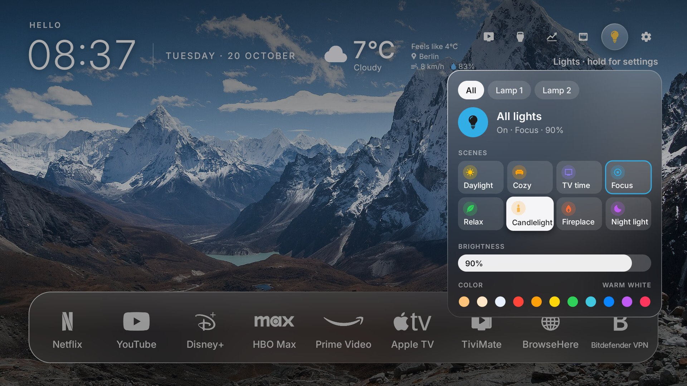
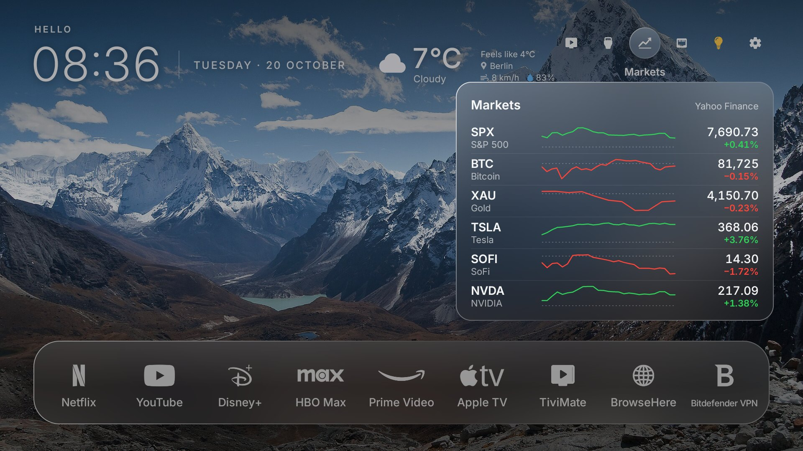

<div align="center">


# At Yazılım

**A calm, Apple TV-style home screen for Google TV and Android TV.**

Nature photos behind everything, Liquid Glass (even on Android 12), the weather at a glance, a markets panel,
a guest Wi-Fi QR code and your WiZ lights on the remote. No ads. One button to undo.


</div>

> At Yazılım ("at" is Turkish for *horse*: hence the Trojan horse icon 🐴) is a fork of
> [Free My TV](https://github.com/simbasjungles/free-my-tv) by simbasjungles and contributors, reworked into a
> photo-first, Apple TV-like look and extended with smart-home and everyday features. Built with
> [Claude Code](https://claude.com/claude-code).

## What you get

- **Nature photos behind everything.** 15 featured photos from Wikimedia Commons (alpine lakes, the Himalayas,
  Cappadocia, Pamukkale…): a new one every hour, daytime photos by day and warm dusk ones at night, each credited
  on screen.
- **Liquid Glass, even on Android 12.** Every glass surface shows the blurred photo behind it through a slight lens,
  with light on top and a specular rim. On TVs without Android 13 shaders it's drawn with the plain Canvas, so it
  stays smooth on weak TV chips.
- **Your apps on a glass bar.** White brand marks with their names, the focused app on a lit pane of glass (after
  [CleanFrame](https://github.com/nthnclrk/CleanFrame)).
- **The weather at a glance.** Temperature, sky, feels-like, wind and humidity next to the clock; OK shows the next
  8 hours, sunrise and sunset. [Open-Meteo](https://open-meteo.com), no key.
- **Markets (optional).** A button for your watchlist: price, change since the last close and today's curve.
- **WiZ smart lights.** OK on the bulb switches every lamp on or off; hold OK for a panel: all lamps or one at a
  time, 8 scenes (Daylight, Cozy, TV time, Focus, Relax, Candlelight, Fireplace, Night light), brightness and
  colour. Home network only: no account, no cloud.
- **Guest Wi-Fi QR code.** OK on the network button shows a QR code that guests scan with their phone's camera.
- **Turkish and English**, following the TV's language or switched in the settings.
- **No ads, a lighter TV.** The stock launcher and the promo and tracking apps are turned off, never uninstalled
  (on Sony: Samba TV's viewing tracker, Sony Select, promos, the store demo). On our Sony BRAVIA the Home button went
  from 173 ms to 78 ms and free memory from 358 MB to 399 MB.
- **Safe.** No root. One button brings back the TV's original home screen, and a watchdog does it by itself if the
  new one ever crashes three times in five minutes.

<p align="center">


</p>

## Tested on

- **Sony BRAVIA 4K VH21** (Google TV, Android 12): At Yazılım's own TV.
- Free My TV was built on a **TCL** Google TV (Android 14), whose lists are still here.

Other Google TV and Android TV sets (Android 12 or newer) and Google TV streamers should work; another brand's promo
apps may need adding to the lists (see [Any TV](#any-tv)). Samsung or LG: plug a Google TV streamer into HDMI.

## Install

About fifteen minutes. You need a Google TV or Android TV (Android 12+) and a computer that can reach it.

1. **On the TV**, turn on developer mode: Settings → System → About → press *Android TV OS build* 7 times. Then in
   Settings → System → Developer options turn on **USB debugging** (on Sony it's called **ADB debugging**). Note
   the TV's IP address (Settings → Network & Internet).
2. **On your computer**, get the code:
   ```bash
   git clone https://github.com/aliakay/glass-tv-launcher && cd glass-tv-launcher
   ```
3. **The easy way:** open [Claude Code](https://claude.com/claude-code) in that folder and say
   > Install At Yazılım on my TV at 192.168.1.50. I live in Berlin.

   **The manual way:** install a JDK 17+, the Android SDK command-line tools (`build-tools;34.0.0`,
   `platforms;android-34`) and adb, then:
   ```bash
   ./build.sh                       # the first run creates config.properties: set your city there
   ./build.sh
   adb connect 192.168.1.50:5555    # accept "Allow USB debugging?" on the TV (tick "Always allow")
   adb install -r FreeMyTV.apk
   ```
4. **On the TV**, open *At Yazılım* → *Home Screen* → *At Yazılım*, and accept the debugging prompt once more (the
   app uses the TV's own ADB to switch the home screen).

**Computer and TV on different networks?** Install [Tailscale](https://tailscale.com) on both (it's in the TV's
Play Store) and use the TV's Tailscale address: `adb connect 100.x.y.z:5555`. That's how At Yazılım was built and
installed, from a server in another city.

## Settings

Everything lives in `config.properties`, created by the first build. It stays on your computer (it's in
`.gitignore`); change it, run `./build.sh` and install again.

| Key | What it does | Default |
|---|---|---|
| `latitude`, `longitude`, `city` | Your city: the weather, and the sunset that turns the interface dark | New York |
| `name` | The greeting at the top left ("Hello Ali") | empty |
| `language` | `auto` (follows the TV), `en` or `tr` | `auto` |
| `temperature` | `C`, `F` or `auto` | `auto` |
| `stocks` | Your watchlist, Yahoo Finance symbols: `^GSPC:SPX,BTC-USD:BTC,GC=F:XAU,TSLA,NVDA` (empty = no markets button) | empty |
| `guest_wifi_ssid`, `guest_wifi_password`, `guest_wifi_security` | The guest network for the QR code (`WPA`, `WEP` or `nopass`) | empty |
| `disable_assistant` | Also turn off Google Assistant | `false` |

Keep `freemytv.keystore`: updates must be signed with the same key.

## On the remote

| Where | OK | Hold OK |
|---|---|---|
| An app | Opens it | |
| Weather | The next hours | |
| Markets | Your watchlist | |
| Network | The guest Wi-Fi QR code | The TV's network settings |
| Bulb | All lamps on / off | The lights panel |
| ↓ on the apps | Inputs, All Apps, settings | |

## Going back

On the TV: *At Yazılım* → *Home Screen* → *Original*. The factory home screen, screensaver and every app come back
exactly as they were. To remove it for good, switch to *Original* first, then uninstall it (Settings → Apps).

## Any TV

The apps turned off and the ones never touched are lists in
[`HomeMode.java`](app/src/io/freemytv/HomeMode.java) (`DEBLOAT`, `PROTECTED`); the shelf is `SHELF` in
[`HomeApps.java`](app/src/io/freemytv/HomeApps.java) and the white marks are `GLYPHS` in
[`HomeView.java`](app/src/io/freemytv/HomeView.java). With Claude Code, say *"set it up for my Philips"*: it reads
your TV and updates the lists ([CLAUDE.md](CLAUDE.md) tells it how).

## How it works

- **A plain Android app, no Gradle, no libraries.** [`build.sh`](build.sh) runs aapt2 → javac → d8 → zipalign →
  apksigner.
- **The TV's own ADB, from inside the TV**, sets the home screen and screensaver and turns apps off
  (`cmd package set-home-activity`, `pm disable-user`). Nothing listens to the network.
- **Drawn by hand on one Canvas.** Android 13+ gets AGSL shaders; Android 12 gets `Wallpaper` + `LiquidGlass`.
- **WiZ** lamps are found with a broadcast on UDP port 38899 and driven with their local `setPilot` API.
- **QR codes** come from a small built-in encoder (`QrCode.java`).

## Credits and licences

- **Code:** MIT ([LICENSE](LICENSE)), from [Free My TV](https://github.com/simbasjungles/free-my-tv) by simbasjungles
  and contributors (MIT). Forked at `501bc3c` (October 2026); Free My TV has added more since (a shelf editor,
  Spanish, remote buttons), which may be merged later.
- **Design:** the glass app bar and the monochrome marks follow
  [CleanFrame](https://github.com/nthnclrk/CleanFrame) by Nathan Clark (MIT).
- **App marks:** [Simple Icons](https://simpleicons.org) (CC0) and
  [Custom Brand Icons](https://github.com/elax46/custom-brand-icons) (MIT); see
  [`LICENSE-app-icons.txt`](app/assets/symbols/LICENSE-app-icons.txt). Brand names and marks belong to their owners
  and are used only to identify the apps.
- **Photos:** Wikimedia Commons featured pictures under CC BY, CC BY-SA and the Free Art License, each with its own
  terms: see [`CREDITS.md`](app/assets/wallpapers/CREDITS.md). They are not covered by the MIT licence.
- **Fonts and symbols:** [Inter](https://rsms.me/inter/) (SIL OFL 1.1), [Material Symbols](https://fonts.google.com/icons)
  (Apache 2.0).
- **Data:** weather by [Open-Meteo.com](https://open-meteo.com/) (CC BY 4.0). Markets use Yahoo Finance's public
  chart data, which is unofficial and may be delayed: it's meant for personal use, and an empty `stocks` turns it off.
- **QR encoder** after the algorithm of [Project Nayuki's QR Code generator](https://www.nayuki.io/page/qr-code-generator-library).

Not affiliated with Sony, Google, TCL, WiZ, Yahoo or any streaming service.
