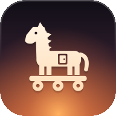
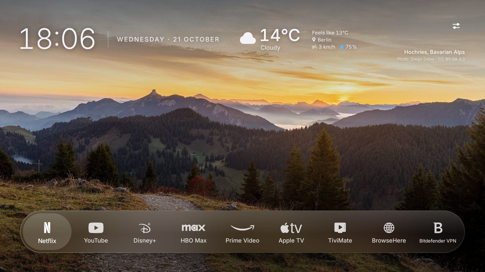
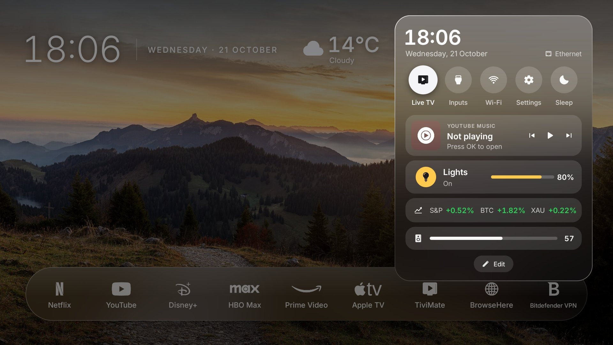
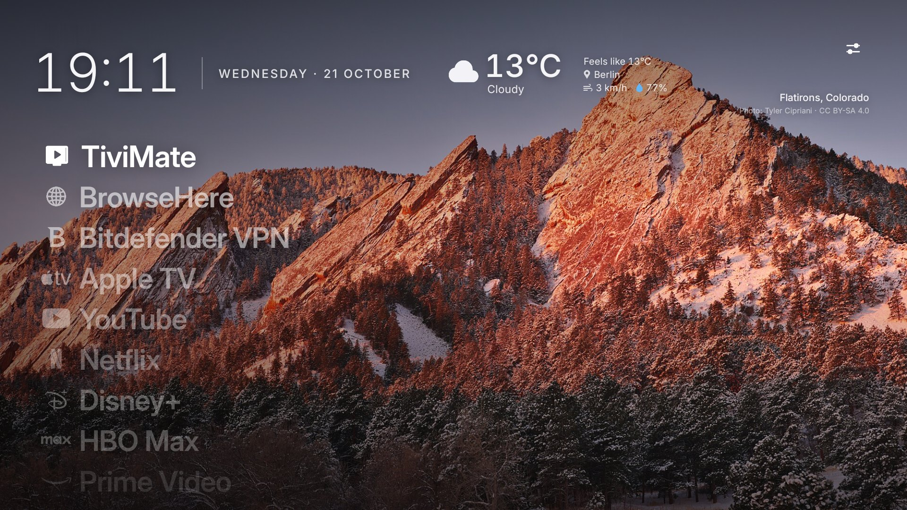
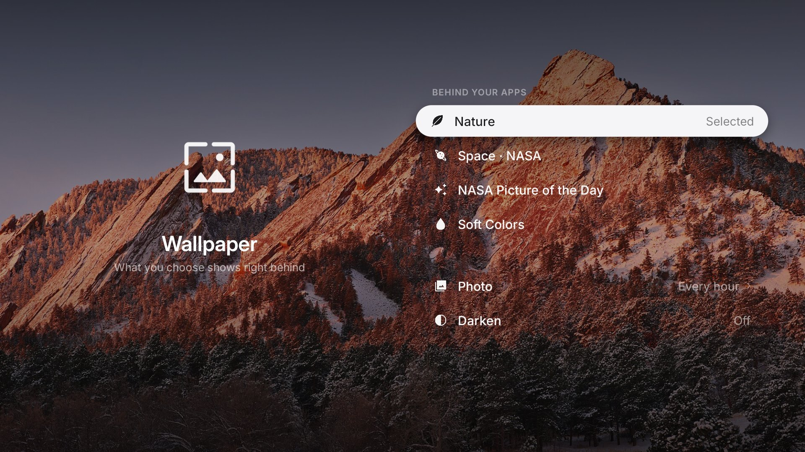
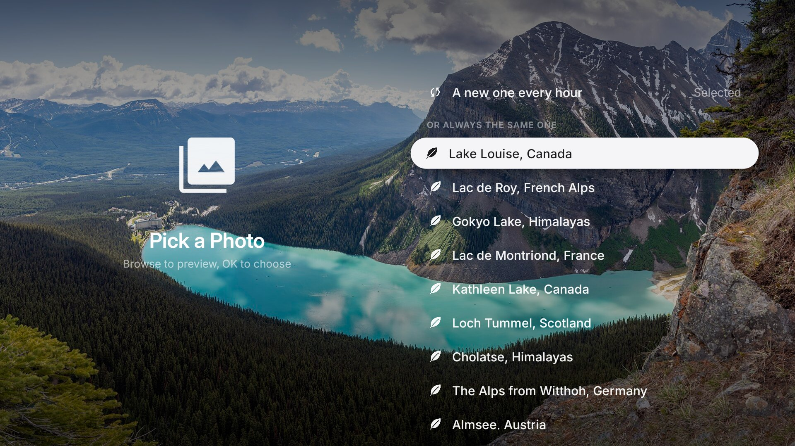
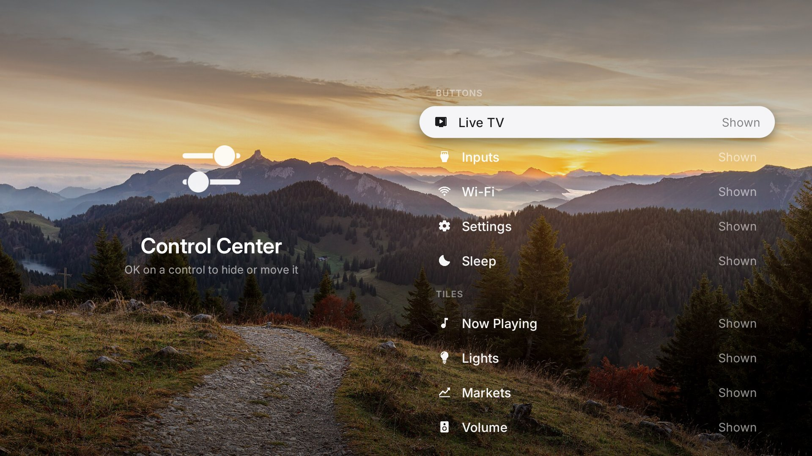

<div align="center">



# TroiaOS Launcher

**A calm, customizable launcher for Google TV and Android TV.**

Nature photos behind everything, Liquid Glass (even on Android 12), an Apple-style Control Center, "continue
watching" for any app, and your apps as a glass dock or a big list. Set it all up on the TV itself. No ads, no root.
One button to undo.



</div>

> TroiaOS is named after Troia (Troy, *Truva* in Turkish), hence the Trojan horse icon 🐴. It is a fork of
> [Free My TV](https://github.com/simbasjungles/free-my-tv) by simbasjungles and contributors, reworked into a
> photo-first, Apple TV-like look and extended with smart-home and everyday features. Built with
> [Claude Code](https://claude.com/claude-code).

## What you get

- **Photos behind everything, your choice.** Nature (15 featured photos from Wikimedia Commons: alpine lakes, the
  Himalayas, Cappadocia, Pamukkale…), Space (14 public-domain NASA photos: Hubble, Webb, Cassini, Artemis II), NASA's
  Astronomy Picture of the Day, or soft colours. A new one every hour or one you pick (previewed as you browse), and
  darker if you like. Each is credited on screen.
- **Liquid Glass, even on Android 12.** Every glass surface shows the blurred photo behind it through a slight lens,
  with light on top and a specular rim. On TVs without Android 13 shaders it's drawn with the plain Canvas, so it
  stays smooth on weak TV chips.
- **Your apps on a glass bar.** White brand marks with their names on a glass capsule, the focused app on a soft pill
  of light (after [CleanFrame](https://github.com/nthnclrk/CleanFrame)). Any installed app can go there: hold OK on
  an app to move it, remove it or add another.
- **Control Center.** One button next to the weather opens a glass panel, like Apple's: Live TV, inputs, Wi-Fi,
  settings, sleep and Free RAM; Now Playing (Spotify, YouTube Music or whatever is playing: cover, song, ⏮ ⏯ ⏭); the lights with their
  brightness; the markets; the volume. Choose which of these show, and in what order. While music plays, the
  screensaver shows it too: a frosted card with the cover, the song and how far into it.
- **Dock or List.** The apps on a glass dock at the bottom, or as a list of big names over the photo (after
  CleanFrame's Photo List): Settings → Customize → Home Screen → Apps Layout.
- **Continue watching.** Focus YouTube (or any app) in the dock and a card shows what you left half-way: its
  picture, when you watched it, the title, the channel, the time left, and the latest from another app. ↑ to the
  card and OK picks it up (a YouTube video at the second you stopped, when the app tells which video it was).
- **Make it yours, on the TV.** Settings → *Customize*: the dock's apps, Control Center's controls, the greeting,
  the weather's city (search it by name), °C or °F, your watchlist, the language, the wallpaper, your lights, the
  guest Wi-Fi and your music app. No computer and no rebuild needed.
- **The weather at a glance.** Temperature, sky, feels-like, wind and humidity next to the clock; OK shows the next
  8 hours, sunrise and sunset. [Open-Meteo](https://open-meteo.com), no key.
- **Markets (optional).** A button for your watchlist: price, change since the last close and today's curve.
- **Smart lights, many brands.** WiZ, LIFX and Govee are found by themselves; a Philips Hue Bridge pairs with its
  button; Home Assistant brings in any other brand. All lamps or one at a time, 8 scenes, brightness and colour;
  rename lamps, hide some, blink one to tell which is which. Home network only: no account, no cloud.
- **Guest Wi-Fi QR code.** Type your guest network on the TV (Customize → Guest Wi-Fi QR); guests scan the code
  with their phone's camera and join without typing the password.
- **Free RAM.** One button in Control Center closes the apps resting in the background and shows what came back.
- **Private by design.** No account, no ads, no tracking, no TroiaOS servers: see [Privacy](#privacy).
- **Turkish and English**, following the TV's language or switched in the settings.
- **No ads, a lighter TV.** The stock launcher and the promo and tracking apps are turned off, never uninstalled
  (on Sony: Samba TV's viewing tracker, Sony Select, promos, the store demo). On our Sony BRAVIA the Home button went
  from 173 ms to 78 ms and free memory from 358 MB to 399 MB.
- **Safe.** No root. One button brings back the TV's original home screen, and a watchdog does it by itself if the
  new one ever crashes three times in five minutes.

## Screenshots

<p align="center">


</p>
<p align="center">


</p>
<p align="center">

</p>

Control Center · the List layout · Wallpaper · the photo picker · Customize. All taken on a Sony BRAVIA (October
2026).

## Tested on

- **Sony BRAVIA 4K VH21** (Google TV, Android 12): TroiaOS's own TV.
- Free My TV was built on a **TCL** Google TV (Android 14), whose lists are still here.

Other Google TV and Android TV sets (Android 12 or newer) and Google TV streamers should work; another brand's promo
apps may need adding to the lists (see [Any TV](#any-tv)). Samsung or LG: plug a Google TV streamer into HDMI.

**Checked on the BRAVIA:** the dock and the List layout, Control Center (Now Playing, lights, markets, volume, Free
RAM), Customize (dock, Control Center, home screen, wallpaper), the photo and NASA wallpapers, Continue watching with
YouTube, WiZ lights, the guest Wi-Fi QR panel and the screensaver.

**Not yet checked on a real TV:** Set Up and its handwritten "hello", the ⚙ button next to Control Center, the
Customize pages for Lights, Guest Wi-Fi, Music App and Privacy, the screensaver's Now Playing card, and YouTube
resuming at the exact second. LIFX, Govee, Philips Hue and Home Assistant follow their published protocols but
haven't met a real lamp yet: reports welcome.

## Install

About fifteen minutes. You need a Google TV or Android TV (Android 12+) and a computer that can reach it.

1. **On the TV**, turn on developer mode: Settings → System → About → press *Android TV OS build* 7 times. Then in
   Settings → System → Developer options turn on **USB debugging** (on Sony it's called **ADB debugging**). Note
   the TV's IP address (Settings → Network & Internet).
2. **On your computer**, get the code:
   ```bash
   git clone https://github.com/aliakay/TroiaOS-Launcher && cd TroiaOS-Launcher
   ```
3. **The easy way:** open [Claude Code](https://claude.com/claude-code) in that folder and say
   > Install TroiaOS on my TV at &lt;TV-IP&gt;. I live in &lt;your city&gt;.

   **The manual way:** install a JDK 17+, the Android SDK command-line tools (`build-tools;34.0.0`,
   `platforms;android-34`) and adb, then:
   ```bash
   ./build.sh                       # the first run creates config.properties: set your city there
   ./build.sh
   adb connect <TV-IP>:5555         # accept "Allow USB debugging?" on the TV (tick "Always allow")
   adb install -r FreeMyTV.apk
   ```
4. **On the TV**, open *TroiaOS* → *Home Screen* → *TroiaOS*, and accept the debugging prompt once more (the
   app uses the TV's own ADB to switch the home screen).

**Computer and TV on different networks?** Install [Tailscale](https://tailscale.com) on both (it's in the TV's
Play Store) and use the TV's Tailscale address: `adb connect 100.x.y.z:5555`. That's how TroiaOS was built and
installed, from a server in another city.

## Set it up on the TV

The first time you open TroiaOS from the TV's apps, **Set Up** greets you: "hello" is written by hand, then the word
in other languages. Press OK and the remote walks you through it, one step at a time: the language, your name, your
city (for the weather), your apps, the wallpaper, lights, a guest Wi-Fi QR code, the music app, a watchlist, what
TroiaOS does with data, and making TroiaOS the home screen. Every choice is saved at once; leave half-way and it opens
where you left it. *Later* on the first screen puts it off for good, and Settings → *Set Up Again* runs it any time
with what you already chose.

After that, everything is set on the TV with the remote: Settings → *Customize* (or hold OK on a dock app, or *Edit*
at the bottom of Control Center).

| Page | What you set |
|---|---|
| Apps on Home | The dock's apps: add any installed app, move, remove |
| Control Center | Which controls show, and their order |
| Home Screen | Dock or List, your name for the greeting, the weather's city, °C / °F, the watchlist, the language |
| Wallpaper | Nature, Space · NASA, NASA Picture of the Day or Soft Colors; one photo or a new one every hour; darken |
| Lights | Search, rename, hide or blink lamps; pair a Philips Hue Bridge; connect Home Assistant |
| Guest Wi-Fi QR | The network name, password and security for the QR code |
| Music App | What Now Playing opens when nothing plays (Spotify, YouTube Music, any app) |
| Privacy | What TroiaOS sends where (below) |

**Lights, by brand:**

- **WiZ:** nothing to do; keep "Allow local communication" on in the WiZ app (it is by default).
- **LIFX:** nothing to do; they answer on the home network.
- **Govee:** turn on *LAN Control* for each lamp in the Govee app (only models that have it).
- **Philips Hue:** Customize → Lights → Philips Hue. The TV finds the bridge; press its round button, then
  *Connect*.
- **Anything else (IKEA, Nanoleaf, Tapo, Zigbee, Matter…):** through [Home Assistant](https://www.home-assistant.io).
  Customize → Lights → Home Assistant: its address (found on the network when it can be), then a long-lived
  access token (Home Assistant → your profile → Security). Typing a long token with a remote is no fun: the Google
  TV app on your phone has a keyboard that can paste it.

## Privacy

TroiaOS has no servers and no account, shows no ads and collects nothing: nothing about you or your TV is ever sent
to us. What goes out, and to whom, is all on Customize → Privacy:

| What | Goes to | What they see |
|---|---|---|
| Weather | [Open-Meteo](https://open-meteo.com) | Your city's coordinates (from the city you chose) |
| City search | Open-Meteo | The name you type |
| Markets (only with a watchlist) | Yahoo Finance | Your symbols |
| NASA picture (only if chosen) | NASA (science.nasa.gov) | That the feed was read |

All of these use HTTPS. Like any website, each of them also sees your internet address.

What stays at home:

- **Lights** are spoken to on your home network only. Plain HTTP (the Hue Bridge, a local Home Assistant) is only
  ever used with home-network addresses; the app refuses it for anything on the internet.
- **The Wi-Fi password, the Hue key and the Home Assistant token** are encrypted with a key in the TV's Android
  Keystore, which never leaves the TV. Keyboards are told not to learn them.
- **Now Playing and Continue Watching** read what plays on the TV itself; the app reads no notifications, and
  nothing of it leaves the TV.
- **The TV's own ADB** is only used, from inside the TV, for the app's own fixed commands (switching the home screen,
  sleep, Free RAM).
- **Android backup is off**, so the settings never go to a cloud backup.

## Defaults for a build (optional)

`config.properties`, created by the first build, holds the defaults a fresh install starts with (handy when you
set up a TV for someone). It stays on your computer (it's in `.gitignore`); change it, run `./build.sh` and install
again. Anything changed on the TV wins over it.

| Key | What it does | Default |
|---|---|---|
| `latitude`, `longitude`, `city` | Your city: the weather, and the sunset that turns the interface dark | New York |
| `name` | The greeting at the top left ("Hello Ali") | empty |
| `layout` | How the apps show: `dock` (glass bar) or `list` (big names over the photo) | `dock` |
| `dock` | The dock's apps by package, in order: `com.netflix.ninja,com.google.android.youtube.tv` | the known streaming apps that are installed |
| `language` | `auto` (follows the TV), `en` or `tr` | `auto` |
| `temperature` | `C`, `F` or `auto` | `auto` |
| `stocks` | Your watchlist, Yahoo Finance symbols: `^GSPC:SPX,BTC-USD:BTC,GC=F:XAU,TSLA,NVDA` (empty = no markets button) | empty |
| `guest_wifi_ssid`, `guest_wifi_password`, `guest_wifi_security` | A starting guest network for the QR code (`WPA`, `WEP` or `nopass`); better set on the TV | empty |
| `disable_assistant` | Also turn off Google Assistant | `false` |

Keep `freemytv.keystore`: updates must be signed with the same key.

## On the remote

| Where | OK | Hold OK |
|---|---|---|
| An app | Opens it | Customize → Dock, on that app (move, remove, add) |
| Weather | The next hours | |
| Control Center | Opens it | |
| ⚙ (right of Control Center) | TroiaOS's Settings: home screen, Customize, Set Up Again | |
| ↑ from an app with a card | The card: OK continues it (↓ to the other app's row) | |
| ↓ on the apps | Inputs, All Apps, settings | |

In Control Center:

| Where | OK | ← → | Hold OK |
|---|---|---|---|
| Now Playing | Play / pause (nothing playing: opens your music app) | Previous / next song | Opens the music app |
| Lights | All lamps on / off (none yet: sets them up) | Brightness | The lights panel |
| Markets | Your watchlist | | |
| Volume | Mute | Down / up | |
| Free RAM | Closes background apps, shows the memory freed | | |
| Edit | Customize (every page) | | |

## Going back

On the TV: *TroiaOS* → *Home Screen* → *Original*. The factory home screen, screensaver and every app come back
exactly as they were. To remove it for good, switch to *Original* first, then uninstall it (Settings → Apps).

## Any TV

The apps turned off and the ones never touched are lists in
[`HomeMode.java`](app/src/io/freemytv/HomeMode.java) (`DEBLOAT`, `PROTECTED`). Any app can go in the dock from the
TV; `SHELF` in [`HomeApps.java`](app/src/io/freemytv/HomeApps.java) lists the known ones (the default dock, with
their look) and their white marks are `GLYPHS` in [`HomeView.java`](app/src/io/freemytv/HomeView.java). An app with
no mark shows the logo lifted from its TV banner. With Claude Code, say *"set it up for my Philips"*: it reads
your TV and updates the lists ([CLAUDE.md](CLAUDE.md) tells it how).

## How it works

- **A plain Android app, no Gradle, no libraries.** [`build.sh`](build.sh) runs aapt2 → javac → d8 → zipalign →
  apksigner.
- **The TV's own ADB, from inside the TV**, sets the home screen and screensaver and turns apps off
  (`cmd package set-home-activity`, `pm disable-user`). Nothing listens to the network.
- **Drawn by hand on one Canvas.** Android 13+ gets AGSL shaders; Android 12 gets `Wallpaper` + `LiquidGlass`.
- **Lights** (`Lights`): WiZ (UDP 38899, `setPilot`), LIFX (its LAN protocol, UDP 56700), Govee (LAN API: multicast
  scan on 4001, commands on 4003), Philips Hue (the bridge's local API) and Home Assistant (its REST API), all on the
  home network. The Hue Bridge and Home Assistant are found with mDNS (`Nsd`).
- **QR codes** come from a small built-in encoder (`QrCode.java`).

## Credits and licences

- **Code:** MIT ([LICENSE](LICENSE)), from [Free My TV](https://github.com/simbasjungles/free-my-tv) by simbasjungles
  and contributors (MIT). Forked at `501bc3c` (October 2026); Free My TV has added more since (a shelf editor,
  Spanish, remote buttons), which may be merged later.
- **Design:** the glass app bar and the monochrome marks follow
  [CleanFrame](https://github.com/nthnclrk/CleanFrame) by Nathan Clark (MIT).
- **App marks:** [Simple Icons](https://simpleicons.org) (CC0) and
  [Custom Brand Icons](https://github.com/elax46/custom-brand-icons) (MIT); see
  [`LICENSE-app-icons.txt`](app/assets/symbols/LICENSE-app-icons.txt). Brand names and marks belong to their owners
  and are used only to identify the apps.
- **Photos:** Wikimedia Commons featured pictures under CC BY, CC BY-SA and the Free Art License, and public-domain
  NASA pictures, each with its own terms: see [`CREDITS.md`](app/assets/wallpapers/CREDITS.md). They are not covered
  by the MIT licence. NASA's Astronomy Picture of the Day is downloaded on the TV, and only on days whose credit is
  public agencies alone (many APOD pictures belong to their photographers). NASA doesn't endorse TroiaOS.
- **Fonts and symbols:** [Inter](https://rsms.me/inter/) (SIL OFL 1.1), [Material Symbols](https://fonts.google.com/icons)
  (Apache 2.0).
- **Set Up's handwritten "hello":** from the Hershey Script font (`tools/make_hello.py`). The Hershey Fonts were
  originally created by Dr. A. V. Hershey while working at the U. S. National Bureau of Standards; the format of the
  font data it was read from was originally created by James Hurt, Cognition, Inc. See
  [`CREDITS.md`](app/assets/setup/CREDITS.md).
- **Data:** weather by [Open-Meteo.com](https://open-meteo.com/) (CC BY 4.0). Markets use Yahoo Finance's public
  chart data, which is unofficial and may be delayed: it's meant for personal use, and an empty `stocks` turns it off.
- **QR encoder** after the algorithm of [Project Nayuki's QR Code generator](https://www.nayuki.io/page/qr-code-generator-library).

Not affiliated with Sony, Google, TCL, WiZ, LIFX, Govee, Signify (Philips Hue), Home Assistant, NASA, Spotify,
Yahoo or any streaming service.
